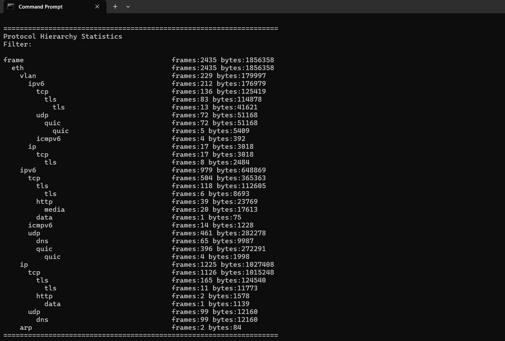
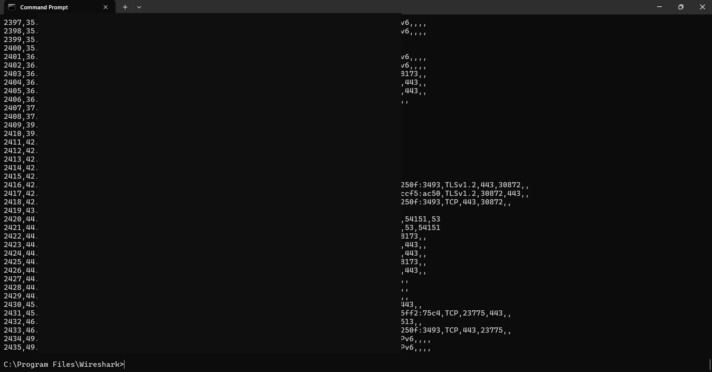
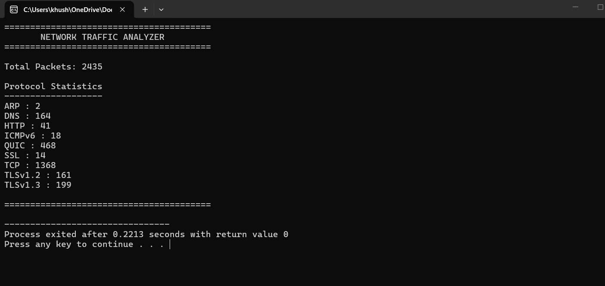
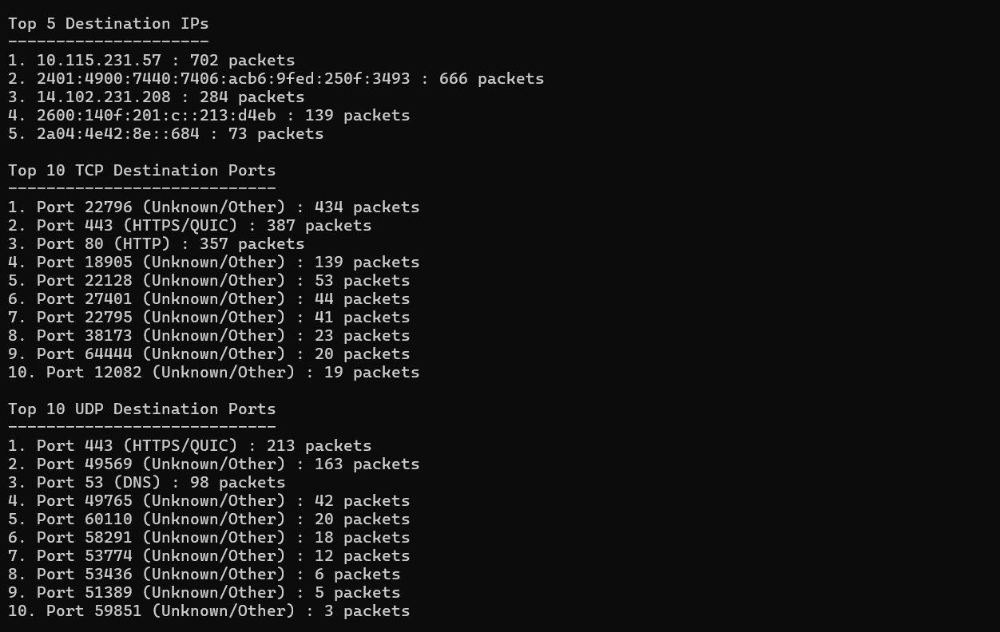
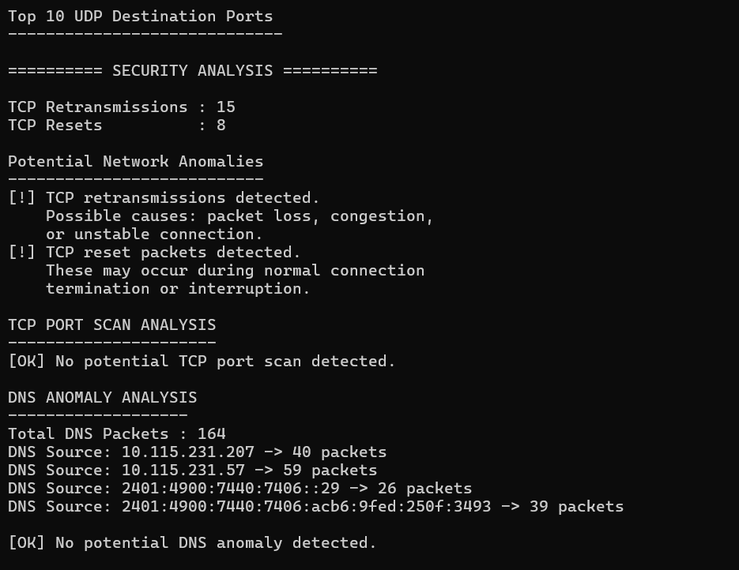
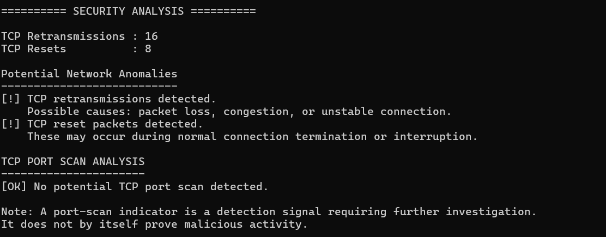
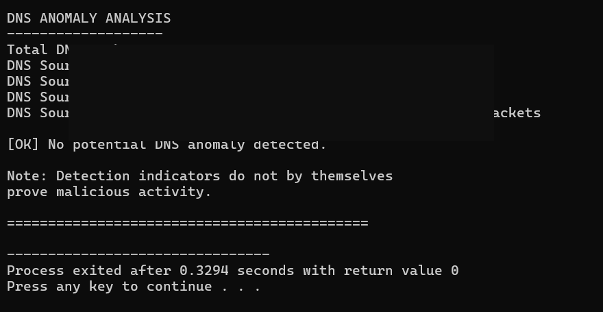

<div align="center">

# 🛡️ Network Traffic Analyzer
### & Security Monitoring Dashboard

**Analyze. Detect. Visualize. Understand.**

An offline network traffic analysis tool built with C++, TShark, Wireshark and JavaScript to analyze packet captures and identify potential network anomalies.

<br>


</div>

---

## 📌 Overview

The **Network Traffic Analyzer & Security Monitoring Dashboard** is a cybersecurity project designed to examine captured network traffic, extract packet-level information, analyze communication protocols, and highlight potential security indicators.

It combines a C++-based analysis engine with a browser-based dashboard to make network traffic analysis easier to understand and visualize.

The project uses an offline PCAPNG capture processed through TShark.

## 📊 Project Highlights

| Metric | Analyzed Result |
|:---|---:|
| Total packets | **2,435** |
| TCP packets | **1,783** |
| UDP packets | **632** |
| DNS packets | **164** |
| HTTP packets | **41** |
| QUIC packets | **468** |
| TCP retransmissions | **16** |
| TCP resets | **8** |

## 🖥️ Dashboard Preview

_public.png)

## ⚙️ How It Works

The project follows a packet-processing and analysis pipeline:

```text
       PCAPNG Capture
              |
              ▼
       TShark Extraction
              |
              ▼
        CSV Packet Data
              |
              ▼
      C++ Analysis Engine
              |
        ┌─────┴─────┐
        ▼           ▼
   Analysis      Dashboard
    Report         Data
                    |
                    ▼
             HTML / CSS / JS
                    |
                    ▼
          Security Dashboard
```

## 🔍 Core Features

### 01 — Packet & Protocol Analysis
- Total packet counting.
- TCP and UDP traffic analysis.
- DNS and HTTP packet identification.
- TLS and QUIC traffic analysis.
- ICMPv6 packet analysis.
- Protocol statistics and distribution.

### 02 — Network Statistics
- Top source IP addresses.
- Top destination IP addresses.
- Top TCP destination ports.
- Top UDP destination ports.
- Packet frequency analysis.

### 03 — Security Monitoring
- TCP retransmission detection.
- TCP reset packet detection.
- Potential TCP port-scan indicator analysis.
- DNS anomaly analysis.

> **Note:** These are investigation indicators, not proof of malicious activity. Findings require further analysis and context.

### 04 — Web-Based Dashboard
- Traffic overview.
- Protocol activity visualization.
- Security monitoring indicators.
- Network traffic statistics.

## 🧰 Technology Stack

| Technology | Implementation |
|:---|:---|
| C++ | Packet analysis engine |
| TShark | Packet extraction |
| Wireshark | Packet inspection and validation |
| HTML | Dashboard structure |
| CSS | Dashboard styling |
| JavaScript | Dashboard data and visualization |

## 📸 Analysis Screenshots

<details>
<summary><b>View TShark Analysis</b></summary>

### Protocol Hierarchy



### Packet Field Extraction



</details>

<details>
<summary><b>View C++ Analysis</b></summary>

### Protocol Statistics



### Port Statistics



</details>

<details>
<summary><b>View Security Analysis</b></summary>

### Security Monitoring



### TCP Port Scan Analysis



### DNS Anomaly Analysis



</details>

## 📁 Repository Structure

```text
Network-Traffic-Analyzer-Security-Dashboard/
│
├── analyzer/
│   ├── main.cpp
│   └── NetworkTrafficAnalyzer.dev
│
├── dashboard/
│   ├── dashboard.html
│   └── analysis.js
│
├── screenshots/
│   └── Redacted analysis screenshots
│
├── Network_Traffic_Incident_Analysis.docx
│
└── README.md
```

## 🚀 Project Scope

This project performs **offline network traffic analysis** using previously captured PCAPNG data.

It is not a real-time intrusion detection system. Its security indicators are intended to support initial investigation and network troubleshooting.

Raw packet captures containing identifiable network information have been excluded from the public repository.

## 🔮 Future Enhancements

- Real-time network traffic monitoring.
- Advanced anomaly detection.
- SIEM integration.
- Improved alerting and event correlation.
- More detailed security visualizations.

---

<div align="center">

### 👩‍💻 Developed By

**Khushi Kumari**

B.Tech — Information Technology

*Exploring Network Security | Cybersecurity | SOC Analysis*

</div>
